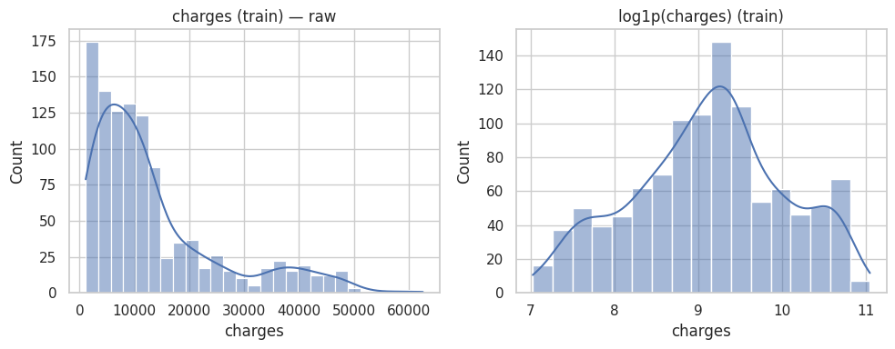
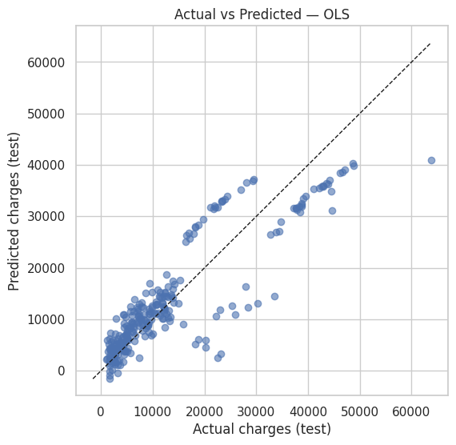
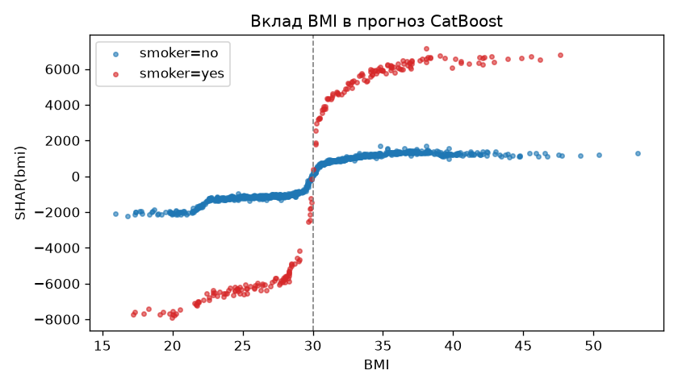
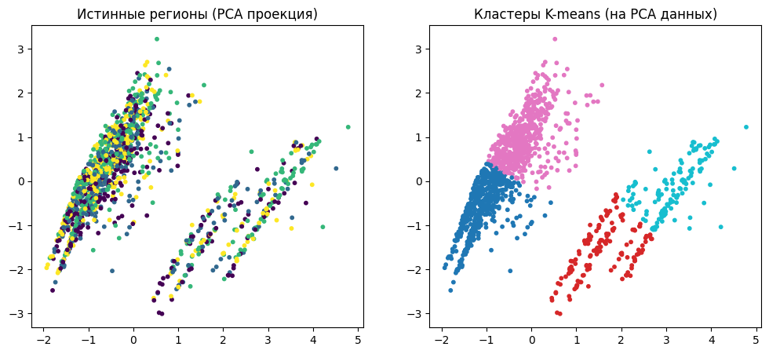

# Classic ML

## Insurance: регрессия

[Ноутбук](../notebooks/insurance_regression.ipynb) · [Метрики](../results/insurance_regression_metrics.csv)

Задача: предсказать `charges` по `age`, `sex`, `bmi`, `children`, `smoker`, `region`. В наборе 1338 строк; split 80/20 с seed 42 даёт 1070 train и 268 test. CSV загружается по URL из ноутбука.

Числовые признаки масштабируются через StandardScaler, категории кодируются OneHotEncoder. Преобразования и регрессор объединены в Pipeline. Для Lasso подбираются четыре значения `alpha` через GridSearchCV (`cv=5`, scoring R²).

- OLS: **RMSE 5796,28, MAE 4181,19, R² 0,7836** на test.
- Lasso с мягкой IQR-фильтрацией: удалена одна train-строка, **RMSE 5806,32, R² 0,7828**.
- Lasso с фильтрацией по target: удалено 116 train-строк, **RMSE 7458,81, R² 0,6416**.

Lasso не улучшил OLS. Удаление дорогих страховок ухудшило качество на исходном test. IQR-пороги вычислены до внутренней CV, а один test используется для сравнения нескольких сценариев. Ранний EDA охватывает весь набор; EDA перед обучением выполнен на train.

## Used cars: ансамбли

[Ноутбук](../notebooks/used_cars_ensembles.ipynb) · [Метрики](../results/used_cars_metrics.csv)

Скачайте `used_cars_UK.csv` по ссылке из [источников](../PROVENANCE.md) и поместите в `data/used_cars_UK.csv` либо задайте `USED_CARS_CSV` до запуска Jupyter.

Подготовка включает заполнение пропусков, объединение редких категорий в `Other` и one-hot encoding. Train/test split: 80/20, seed 42. Для blending train дополнительно разделён 80/20 на base и meta.

Результаты на test, RMSE / MAPE:

- Linear regression: **2258,92 / 35,71%**.
- kNN (k=5): **2291,32 / 27,81%**.
- Decision tree: **2269,76 / 31,83%**.
- Bagging: **1791,49 / 23,35%**.
- Bagging после подбора: **1794,78 / 25,19%**. Проверено 360 конфигураций на пяти folds; лучший CV RMSE **1497,26**.
- Blending: **1979,44 / 28,63%**.
- Stacking: **1984,19 / 26,61%**.
- Stacking с настроенным bagging: **1767,68 / 23,69%**.

Также выполнены подбор decision tree и сравнение метамоделей LinearRegression, RandomForestRegressor и GradientBoostingRegressor.

Импутация и частоты категорий рассчитаны до split. Для строгого сравнения нужна предобработка внутри folds и отдельная финальная выборка: текущий test использован для нескольких сравнений.

### Random forest для классификации региона

Реализация использует `DecisionTreeClassifier`, bootstrap и усреднение вероятностей. После удаления дубликата в insurance осталось 1337 строк; стратифицированное разбиение с seed 42: 1069 train и 268 test.

- sklearn RF: accuracy **0,3843**, macro-F1 **0,3787**.
- Собственный RF: accuracy **0,3955**, macro-F1 **0,3867**.

IQR-клиппинг выполнен до split. Разница на одном test мала; серия повторов и обработка редких классов в bootstrap не проверены.

## Insurance: градиентный бустинг

[Ноутбук](../notebooks/gradient_boosting.ipynb) · [Регрессия](../results/boosting_regression_metrics.csv) · [Классификация](../results/boosting_classification_metrics.csv)

Split 80/20 с seed 42 совпадает с OLS выше. Модели, гиперпараметры и порог выбираются по 5-fold CV на train, test используется один раз в конце каждой части.

Регрессия `charges`, CV RMSE на train:

- OLS: **6123**.
- Без настройки: CatBoost **4706**, HistGradientBoosting **4910**, LightGBM **4938**, XGBoost **5487**.
- CatBoost с early stopping внутри folds: **4550**, в среднем 295 деревьев. После Optuna (30 попыток): **4532**.
- OLS с признаками `obese`, `smoker_obese`, `age2`: **4448**.

Средний |SHAP|: smoker 7616, age 3110, bmi 2072; у sex и region меньше 100. Взаимодействие bmi × smoker (2953) примерно в десять раз сильнее любого другого. Исключение sex и region не улучшило CV.

Test, 268 строк:

- OLS: **R² 0,7836, RMSE 5796**.
- OLS + 3 признака: **R² 0,8773, RMSE 4364, MAE 2390**.
- CatBoost после Optuna: **R² 0,8823, RMSE 4276, MAE 2413**.

Классификация: дорогой клиент, если `charges` не ниже 80-го перцентиля train (20153). Порог вероятности максимизирует F1 на OOF-предсказаниях train.

- Правило «курит»: OOF PR-AUC **0,62**, test F1 **0,811**.
- Логистическая регрессия: OOF PR-AUC **0,841**, test F1 **0,846**.
- Логистическая регрессия + 3 признака: OOF PR-AUC **0,848**, test F1 **0,860**, precision **1,0**, recall **0,754**.
- CatBoost: OOF PR-AUC **0,845**, test F1 **0,863**, precision **0,978**, recall **0,772**.

Набор небольшой, test один, данные без времени. В регрессии разница между двумя лучшими моделями меньше разброса по folds; в классификации их OOF PR-AUC почти равны (0,848 и 0,845).

## Insurance: кластеризация

[Ноутбук](../notebooks/insurance_clustering.ipynb)

1338 строк, шесть признаков: age, bmi, children, charges, sex и smoker. `region` исключён из признаков и используется для расчёта ARI. Кластеризация выполняется на всём наборе без train/test.

Собственный k-means сошёлся за 13 итераций. ARI относительно региона:

- Собственный k-means: **0,0019**.
- sklearn KMeans: **0,0019**.
- AgglomerativeClustering: **0,0027**.
- DBSCAN: **−0,0013**.
- KMeans после StandardScaler и PCA до двух компонент: **0,0025**.

Кластеры почти не совпадают с регионами. Собственный k-means использует одну инициализацию и не обрабатывает пустые кластеры.

## Среда

Установите зависимости из `requirements.txt`. GPU не нужен. Grid search использует `n_jobs=-1`. Версии библиотек для `gradient_boosting.ipynb` указаны в [PROVENANCE.md](../PROVENANCE.md); для лабораторных работ точные версии окружений не сохранились. Данные и исходные Colab перечислены там же.
