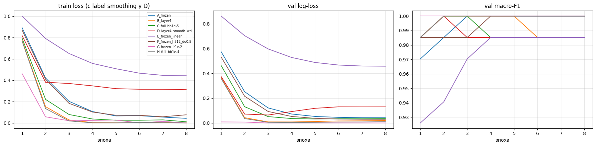
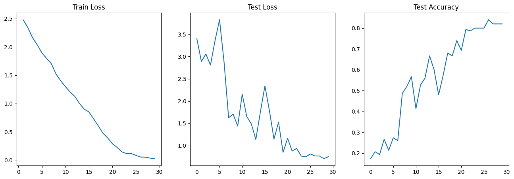

# Computer Vision

## ResNet-50: transfer learning

[Ноутбук](../notebooks/resnet50_transfer_learning.ipynb) · [Seed 42](../results/resnet50_seed42.csv) · [Четыре разбиения](../results/resnet50_four_splits.csv)

Задача: классифицировать изображения по трём метаклассам: фрукты, обувь и бытовая техника. Использованы девять классов ImageNet, по 50 изображений на класс, всего 450. Стратификация по исходным классам даёт 314 train, 68 validation и 68 test.

Сравнены восемь конфигураций: замороженный backbone, обучение `layer4` и всей сети, линейная и MLP-головы, learning rate и регуляризация. Для каждой выполнены четыре разбиения с seed `42, 1, 2, 3`: **32 обучения по 8 эпох**. Веса `IMAGENET1K_V2`, AdamW, cosine scheduler, mixed precision на CUDA. Метрики: accuracy, macro-F1 и cross-entropy; дополнительно classification report и confusion matrix.

Checkpoint выбирается по validation macro-F1, при равенстве по validation loss. Test-метрики показаны для каждой конфигурации.

На seed 42 выбранная конфигурация `G_frozen_lr1e-2` получила **accuracy 98,53% (67/68), macro-F1 0,9852** на test. По четырём разбиениям: **accuracy 0,9890 ± 0,0074, macro-F1 0,9890 ± 0,0073** (mean ± sample std).

Выборка небольшая и относится к домену предобучения. Одна ошибка меняет test accuracy на 1,47 п.п. Разбиения пересекаются, поэтому mean ± std не является доверительным интервалом. Для дальнейшего подбора по test-таблицам нужен новый отложенный набор.

## Спортивные фотографии: residual CNN с нуля

[Ноутбук](../notebooks/sports_residual_cnn.ipynb)

30 видов спорта, **4002 train и 150 отложенных изображений**. Собственные Dataset и сеть из четырёх residual-блоков, BatchNorm, pooling и классификатор на 30 классов. Обучение с нуля: 30 эпох, batch size 64, CrossEntropyLoss, AdamW и CyclicLR.

На train применяются отражения, ElasticTransform и перестановка каналов; на отложенной части случайных аугментаций нет. Модель и оптимизатор сохраняются в checkpoint.

Последняя, 30-я эпоха: **accuracy 0,820 (123/150)**.

Отложенная часть названа `test` в коде, но используется для выбора checkpoint и фактически служит validation. Отдельного финального test нет. Класс `ResidualCNN` содержит по одному residual-блоку на каждую из четырёх стадий.

## Запуск

Установите зависимости из `requirements.txt`, откройте ноутбук в новом kernel и выполните ячейки по порядку. Sports CNN требует CUDA. В сохранённом запуске ResNet-50 использованы PyTorch `2.11.0+cu130` и Tesla T4; точные версии всех зависимостей не зафиксированы.

### ResNet-50

Источники данных и весов приведены в [PROVENANCE.md](../PROVENANCE.md). Если локальных данных нет, ноутбук предложит авторизацию Hugging Face и загрузит выбранные классы из `validation`, по 50 изображений. Доступ к ImageNet нужно получить заранее.

- Данные: `data/imagenet9/`, девять папок с wnid из ноутбука. Другой путь задаётся через `IMAGENET9_DIR`.
- Результаты: `runs/resnet50/` либо `RESNET50_OUT_DIR`.
- В Colab: `/content/imagenet9` и `/content/resnet50-runs`. Сохраните результаты до завершения сессии.
- В Kaggle: подключите ImageNet с каталогами wnid; поиск выполняется в `/kaggle/input`.

`run_experiment` читает кеш JSON. При смене данных или настроек используйте пустой каталог результатов. Для разбора ошибок нужны соответствующие `.pt`-веса.

### Sports CNN

Распакуйте `sports.zip` по ссылке из [источников](../PROVENANCE.md) в `data/sports/` либо задайте `SPORTS_DATA_DIR`. Нужны `sports.csv` со столбцами `filepaths`, `labels`, `data set` и фотографии по путям из CSV. Ноутбук переходит в папку данных; там же сохраняется `best.pth`.
